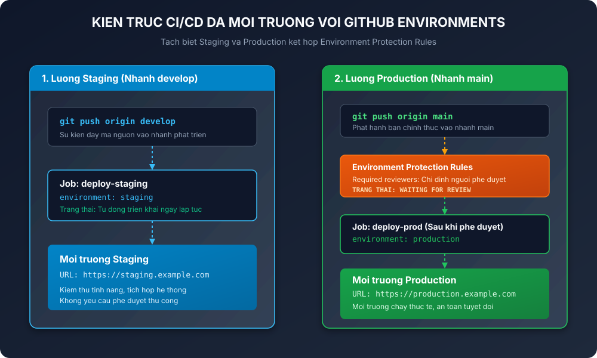
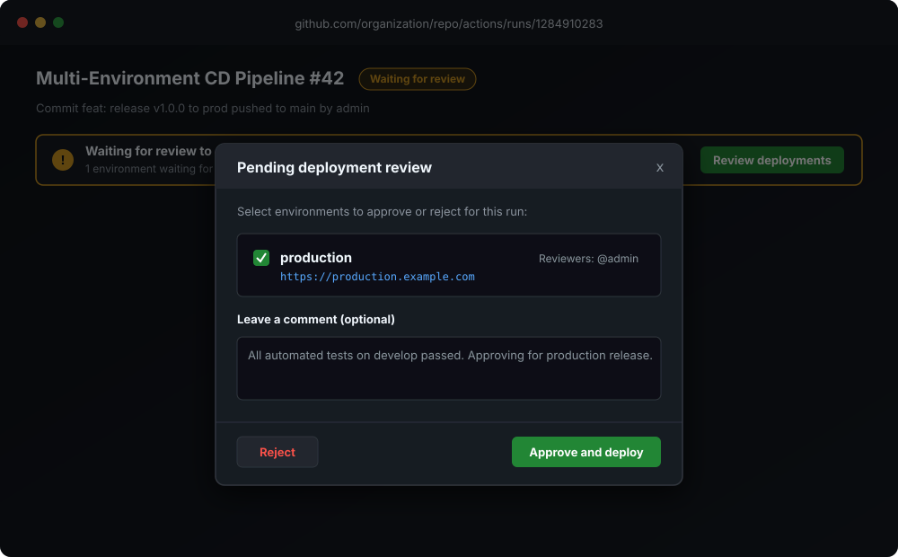

<h1>BAO CAO KY THUAT: TACH BIET LUONG CI/CD DA MOI TRUONG VOI GITHUB ENVIRONMENTS</h1>

<h2>I. MUC TIEU VA TONG QUAN KY THUAT</h2>

Trong quy trinh phat trien phan mem chuyen nghiep, viec trien khai truc tiep tat ca cac thay doi len moi truong Production ma khong qua kiem chung la mot rui ro nghiem trong. Bai thuc hanh nay thiet lap giai phap quan ly ha tang trien khai da moi truong gom Staging va Production su dung tinh nang GitHub Environments.

Muc tieu trong tam:
- Quan ly tach biet ha tang giua Staging (kiem thu, tich hop) va Production (moi truong thuc te cho nguoi dung).
- Thiet lap quy trinh phe duyet thu cong (Environment Protection Rules - Required Reviewers) de kiem soat chat che moi luong phat hanh len Production.
- Xay dung kich ban GitHub Actions dieu phoi theo nhanh: tu dong deploy len Staging khi push vao develop, yeu cau phe duyet truoc khi deploy len Production khi push vao main.

<h2>II. SO DO KIEN TRUC LUONG CD DA MOI TRUONG</h2>

So do duoi day the hien toan bo luong cong viec tu luc lap trinh vien day ma nguon vao cac nhanh tuong ung cho den khi ung dung duoc trien khai toi tung moi truong dich:

<p align="center">
  
</p>

<h2>III. BANG SO SANH CHI TIET HAI MOI TRUONG STAGING VA PRODUCTION</h2>

<table border="1" cellpadding="8" cellspacing="0">
  <thead>
    <tr bgcolor="#1e293b">
      <th style="color: #ffffff;">Tieu chi</th>
      <th style="color: #ffffff;">Moi truong Staging</th>
      <th style="color: #ffffff;">Moi truong Production</th>
    </tr>
  </thead>
  <tbody>
    <tr>
      <td><b>Nhanh kich hoat (Branch)</b></td>
      <td>develop</td>
      <td>main</td>
    </tr>
    <tr>
      <td><b>Muc dich su dung</b></td>
      <td>Kiem thu tinh nang, regression test, tich hop he thong</td>
      <td>Phuc vu nguoi dung cuoi, van hanh thuc te</td>
    </tr>
    <tr>
      <td><b>Co che trien khai</b></td>
      <td>Tu dong hoan toan (Continuous Deployment)</td>
      <td>Kiem soat phe duyet thu cong (Manual Approval Gate)</td>
    </tr>
    <tr>
      <td><b>Quy tac bao ve (Protection Rules)</b></td>
      <td>Khong bat (Trien khai tuc thi)</td>
      <td>Bat Required reviewers (Chi dinh tai khoan duyet)</td>
    </tr>
    <tr>
      <td><b>Duong dan dich (Environment URL)</b></td>
      <td>https://staging.example.com</td>
      <td>https://production.example.com</td>
    </tr>
    <tr>
      <td><b>Rui ro va anh huong loi</b></td>
      <td>Rui ro thap, khong anh huong khach hang</td>
      <td>Rui ro cao nhat, anh huong truc tiep toi uy tin doanh nghiep</td>
    </tr>
  </tbody>
</table>

<h2>IV. HUONG DAN CAU HINH GITHUB ENVIRONMENTS TREN GIAO DIEN REPOSITORY</h2>

De kich hoat tinh nang kiem soat moi truong, thuc hien cac buoc sau tren GitHub Repository:

1. Buoc 1: Truy cap vao muc Settings cua Repository tren trinh duyet.
2. Buoc 2: Chon muc Environments o thanh menu ben trai.
3. Buoc 3: Nhan New environment, nhap ten staging roi nhan Configure environment. Khong can bat Environment protection rules cho staging.
4. Buoc 4: Tiep tuc nhan New environment, nhap ten production roi nhan Configure environment.
5. Buoc 5: Tai trang cau hinh cua production, tich chon muc Required reviewers.
6. Buoc 6: Tim kiem va them tai khoan GitHub ca nhan hoac nguoi quan tri vao danh sach reviewer. Nhan Save protection rules de hoan tat.

<h2>V. PHAN TICH CHI TIET TEP WORKFLOW CD-MULTI-ENV.YML</h2>

Tep kich ban duoc luu tai duong dan .github/workflows/cd-multi-env.yml voi noi dung duoc chuan hoa:

```yaml
name: Multi-Environment CD Pipeline

on:
  push:
    branches:
      - main
      - develop

jobs:
  deploy-staging:
    name: Deploy to Staging
    if: endsWith(github.ref, '/develop')
    runs-on: ubuntu-latest
    environment:
      name: staging
      url: https://staging.example.com
    steps:
      - name: Checkout code
        uses: actions/checkout@v5

      - name: Set up Environment
        run: |
          echo "Target Environment: Staging"
          echo "Branch: ${{ github.ref_name }}"
          echo "Commit SHA: ${{ github.sha }}"

      - name: Deploy to Staging Server
        run: |
          echo "Executing automated deployment to Staging"
          echo "Health check verification passed"
          echo "Deployment completed successfully to https://staging.example.com"

  deploy-prod:
    name: Deploy to Production
    if: endsWith(github.ref, '/main')
    runs-on: ubuntu-latest
    environment:
      name: production
      url: https://production.example.com
    steps:
      - name: Checkout code
        uses: actions/checkout@v5

      - name: Set up Environment
        run: |
          echo "Target Environment: Production"
          echo "Branch: ${{ github.ref_name }}"
          echo "Commit SHA: ${{ github.sha }}"

      - name: Deploy to Production Server
        run: |
          echo "Executing approved deployment to Production"
          echo "Running database migrations"
          echo "Performing rolling zero-downtime update"
          echo "Production deployment live at https://production.example.com"
```

Diem can luu y trong cau hinh:
- Tu khoa on.push.branches: Khai bao ca hai nhanh main va develop de lang nghe su kien day code.
- Bieu thuc if: endsWith(github.ref, '/develop') dam bao Job deploy-staging chi chay khi ma nguon duoc day vao nhanh phat trien.
- Bieu thuc if: endsWith(github.ref, '/main') dam bao Job deploy-prod chi duoc kich hoat khi ma nguon sat nhap vao nhanh main.
- Tu khoa environment: Khai bao ten moi truong trung khop voi ten da tao trong phan Settings de GitHub Actions ap dung chinh xac cac quy tac bao ve.

<h2>VI. KET QUA THUC NGHIEM VA CUA SO PHE DUYET DEPLOYMENT</h2>

Khi tien hanh day code vao nhanh main, GitHub Actions se tu dong kich hoat Job deploy-prod. Tuy nhien, he thong se dung lai truoc cac buoc thuc thi va chuyen sang trang thai Waiting for review:

<p align="center">
  
</p>

Cac buoc thao tac cua Reviewer:
- Khi mo chi tiet Workflow Run tren tab Actions, se thay thong bao mau vang: Waiting for review to deploy to production.
- Nhan nut Review deployments o goc phai.
- Cua so Pending deployment review hien len, danh dau tich vao moi truong production.
- Nhap ghi chu phe duyet vao hop thoai (vi du: All automated tests on develop passed. Approving for production release).
- Nhan nut Approve and deploy mau xanh. Ngay lap tuc Job deploy-prod tiep tuc chay va hoan thanh voi tich xanh thanh cong.

<h2>VII. LENH THUC THI KIEM TRA VA HUONG DAN NOP BAI</h2>

1. Thu nghiem tren moi truong may cuc bo:

```bash
git checkout -b develop
git add .
git commit -m "feat: deploy to staging"
git push origin develop

git checkout main
git merge develop
git push origin main
```

2. San pham nop bai:
- Tep kich ban: .github/workflows/cd-multi-env.yml
- Anh chup man hinh giao dien phe duyet deployment moi truong Production: images/github_environment_approval_ui.svg
- Duong dan nop bai tren he thong: homework/session_12/ex3/
